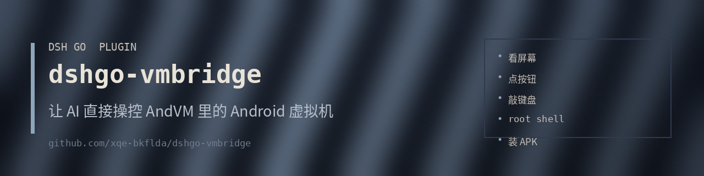
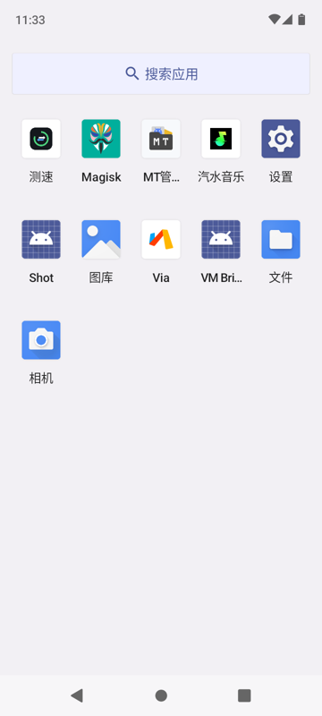

<div align="center">
  
</div>

<p align="center">
[](https://github.com/xqe-bkflda/dsh-go-market)
  [](LICENSE)
  [](https://github.com/xqe-bkflda/dshgo-vmbridge/stargazers)
</p>

# dshgo-vmbridge

**DSH 手机端插件** · 让 AI 直接操控 **AndVM** 里的 Android 虚拟机：看屏幕、点按钮、敲键盘、跑 root shell、装 APK、截图。

> 这是一个 [DSH Go](https://github.com/xqe-bkflda) 手机 App 的本地插件（不是 Cordis 插件，不是桌面端插件）。

手机本身没 root，靠 **AndVM**（基于 Android 官方 AVF 的免 root 虚拟机）开一台有 Magisk root 的 Android 12。
插件跑在 DSH 的 proot 环境里，通过 `adb` 驱动那台虚拟机，把这些能力注册成 AI 可以直接调用的工具。

```
[AI 模型]
   ↓ 调用 vm_* 工具
[local-vmbridge 插件]  ← 跑在 DSH Go 的 proot Ubuntu 里
   ↓ adb (127.0.0.1:5037 fork-server)
[127.0.0.1:<AndVM 调试端口>]  ← 每次重启 AndVM 都会变
   ↓
[AndVM 里的 Android 12 虚拟机]  ← 有 Magisk root
   ├── Shot.apk（无障碍截图，虚拟机里必须装）
   └── 被 AI 操作的各种 App
```



*<sub>上面这张就是插件通过 `vm_screenshot` 拿到的图：AndVM 里的 Android 12 抽屉页，720×1600</sub>*

---

## 前置条件（两个都必须有）

### 1. AndVM 虚拟机

- 装 [AndVM](https://andvm.cn)（包名 `com.lerist.andvm`），在里面创建并启动一台虚拟机
- 虚拟机里打开 **配置 → 调试 → 启用 ADB**
- 调试页会显示「**本机地址 127.0.0.1:NNNNN**」，记下这个端口 —— **每次重启虚拟机都会变**

> 没有 AndVM 就没法用：插件只负责驱动，不提供虚拟机。

### 2. Shot.apk（虚拟机里必装）

**为什么需要它**：AndVM 虚拟机里 `gralloc mapper` 没注册（`/vendor/etc/vintf/manifest.xml` 是空的只读挂载，改不了），
导致 `screencap` 无论 shell 还是 root 都直接 `gralloc-mapper is missing` + `Aborted`，产出 0 字节文件。
`/dev/graphics/`、`/dev/fb*` 都不存在，`LD_PRELOAD` 换 libc++ 会被 linkage namespace 拒绝。

唯一可行的路子是应用内 `AccessibilityService.takeScreenshot()`（API 30+），它不走 gralloc mapper。
所以写了一个 17KB 的 Shot App 专门干这件事。

**安装**（二选一）：

```bash
# 方式 A：让插件自己装（推荐）
vm_shot_setup(reinstall=true)
# 它会：push Shot.apk → pm install -r -g → 启用无障碍 → 自检截一张

# 方式 B：手动
adb -s 127.0.0.1:<端口> install -r -g Shot.apk
adb -s 127.0.0.1:<端口> shell "su -c 'settings put secure enabled_accessibility_services com.dsh.shot/com.dsh.shot.ShotService; settings put secure accessibility_enabled 1'"
```

装完去虚拟机 **设置 → 无障碍 → Shot** 确认是「已开启」状态。

> `Shot.apk` 就在仓库根目录，插件目录里也带了一份。

---

## 安装插件

```bash
# 1. 放到 dsh-go 的插件目录
cp -r dshgo-vmbridge "$DSH_HOME/dsh-go/plugins/local-vmbridge"

# 2. 装进 DSH profile
dsh plugin --profile web add "$DSH_HOME/dsh-go/plugins/local-vmbridge"

# 3. 重启引擎（App → 设置 → 引擎 → 重启）
```

也可以直接把本目录软链到 `$DSH_HOME/dsh-go/plugins/local-vmbridge` 再执行第 2 步。

装好后会话里会出现「**虚拟机桥**」面板，也可以在功能页找到。

---

## 第一次用

```
1. vm_connect_adb(port=40777)      # 填 AndVM 调试页的端口，填数字就行
2. vm_status()                      # 确认 state=device、root=true
3. vm_shot_setup()                  # 装/修截图 App，自检一次出图
4. vm_screen()                      # 看虚拟机当前屏幕（带编号的元素列表）
```

`vm_connect_adb` 三种填法都行：

| 参数 | 例子 | 说明 |
|---|---|---|
| `port` | `40777` | 最省事，自动补 `127.0.0.1:` |
| `addr` | `127.0.0.1:40777` | 完整地址 |
| `scan` | `true` | 自动扫 32768–60999 找在听的 adb（约 60–90 秒） |

端口变了懒得去抄的时候用 `scan`。

---

## 工具清单（22 个）

### 连接
| 工具 | 说明 |
|---|---|
| `vm_status` | 当前端口、device/offline/unauthorized、guest 系统版本、su root 有没有 |
| `vm_connect_adb` | 填 adb 地址并连上（`addr` / `host`+`port` / `scan`） |

### 观察
| 工具 | 说明 |
|---|---|
| `vm_screen` | **主观察工具**。带编号的元素列表，`[3] 设置 可点 @494,334`，编号只在本屏有效 |
| `vm_ui` | 原始 UI 节点（要结构化数据时用） |
| `vm_screenshot` | 截一张存到本机，返回宽高和字节数 |
| `vm_shots` | 连拍几张（看动画/加载） |
| `vm_current` | 当前前台 App / Activity |
| `vm_activity` | Activity 栈顶 |

### 操作
| 工具 | 说明 |
|---|---|
| `vm_tap` | 点。给 `id`（`vm_screen` 的编号）或 `x`/`y` |
| `vm_click` | 按文字点，找可点父节点 |
| `vm_swipe` | 直滑或折线（`points=[[x,y],…]`） |
| `vm_key` | 系统键：back / home / recents / notifications / enter |
| `vm_text` | 往聚焦输入框打字 |

> `vm_tap` / `vm_click` / `vm_swipe` / `vm_key` / `vm_text` 执行完都会**自动重读屏幕**，返回新的 `screen`，不用再调一次 `vm_screen`。

### App 管理
| 工具 | 说明 |
|---|---|
| `vm_apps` | 列已装应用（可按关键字过滤） |
| `vm_start` | 启动 App |
| `vm_install_apk` | 装本机 APK（分块推 → `pm install -r -g -d` → 差集反查包名） |
| `vm_uninstall_apk` | 卸（可 `--user 0` 退让） |
| `vm_apk_info` | 路径、大小、版本、安装时间 |

### Shell / 文件
| 工具 | 说明 |
|---|---|
| `vm_shell` | 跑命令。默认 `su -c`，su 不通自动退回普通 shell |
| `vm_file_push` | 推到虚拟机（>1MB 自动分块） |
| `vm_file_pull` | 从虚拟机拉回来 |

### 截图 App
| 工具 | 说明 |
|---|---|
| `vm_shot_setup` | 装/修 Shot：装 APK、启用无障碍、自检一次出图 |

---

## 典型用法

```
你：看下虚拟机现在是什么界面
AI：vm_screen()
    → 屏幕 720x1600  com.android.launcher3/.QuickstepLauncher（via accessibility）
      [1] 搜索 可点 @360,164
      [2] 设置 可点 @494,334
      ...

你：打开设置，把 WLAN 关掉
AI：vm_tap(id=2)           → 设置页打开，附带新屏幕
    vm_click(text="网络和互联网")
    vm_screen()            → 看到 WLAN 那一行是 [5]
    vm_tap(id=5)
    vm_click(text="关闭")
```

---

## 排障

| 症状 | 原因 / 处理 |
|---|---|
| `连不上 127.0.0.1:NNNNN` | AndVM 重启后端口变了。去调试页抄新端口，或 `vm_connect_adb(scan=true)` |
| `unauthorized` | 虚拟机画面里点「允许 USB 调试」，勾「一律允许」 |
| `offline` | 把 AndVM 的「启用 ADB」关掉再开；端口可能变 |
| `root: false` | Magisk 没授权。虚拟机里 Magisk → 超级用户 → 给「Shell」授权 |
| `截图失败：无障碍服务没连上` | 跑 `vm_shot_setup(reinstall=true)`；还不行就去 设置→无障碍 手动开 Shot |
| `等不到截图` | 无障碍被系统回收了（`am force-stop` 会杀掉它）。`vm_shot_setup()` 重新拉起来 |
| 工具列表里没有 `vm_*` | 插件没加载。`dsh plugin --profile web list` 看有没有 `local-vmbridge`，然后重启引擎 |

### 已知取舍

- **截图慢**：无障碍 `takeScreenshot` 一次 3–6 秒，比 `screencap` 慢，但 `screencap` 在这个虚拟机里根本不工作。
- **截图会带状态栏**：`takeScreenshot` 拿到的是整屏。
- **无障碍与 `am force-stop` 互斥**：`am force-stop com.dsh.shot` 之后要重新启用无障碍。
- **只支持 AndVM**：`127.0.0.1:PORT` 这个形态是 AndVM 的 ADB 调试页给出来的。别的模拟器改 `addr` 也许能连，没测过。

---

## 源码结构

```
dshgo-vmbridge/
├── README.md
├── screenshot.png        # vm_screenshot 的实际输出（示例）
├── package.json          # dshGo 清单：面板 + 工具
├── cordis.patch.yml      # cordis 注入声明
├── Shot.apk              # 虚拟机截图 App（直接装）
├── lib/
│   └── index.js          # 插件主文件：22 个工具 + 面板
└── app/                  # Shot App 源码
    ├── AndroidManifest.xml
    ├── build.sh          # aarch64 上可用的构建脚本
    ├── res/
    │   ├── values/strings.xml
    │   └── xml/shot_a11y.xml
    └── src/com/dsh/shot/
        ├── Main.java           # 极简界面
        ├── ShotReceiver.java   # 广播触发入口
        └── ShotService.java    # takeScreenshot 出图
```

### 在手机上重新编译 Shot.apk

```bash
cd app && bash build.sh
# → Shot.apk
```

`build.sh` 踩过的坑都写在里面了：aarch64 上必须用系统的 `/usr/bin/aapt2`（SDK 里那个是 x86-64），
`-I` 指 `/usr/share/android-framework-res/framework-res.apk`（不是 `android.jar`），
`d8` / `apksigner` 用 `java -jar` 跑。

---

## License

MIT
